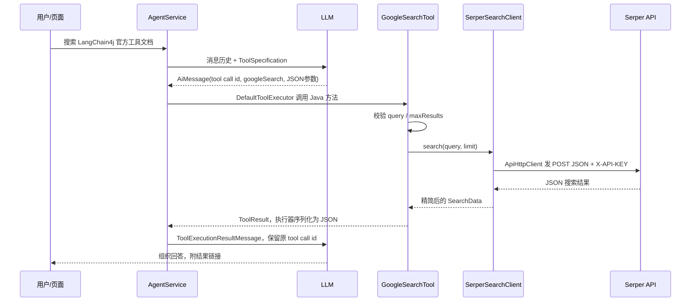

# 从 Tool 到外部 API：阅读与实践

这里沿用你的手写 Agent Loop，不引入另一个 Agent 框架。重点是把“模型想查资料”变成一次可验证、可控制的 Java HTTP 调用。

## 1. 先分清三个概念

| 名称 | 本项目的实例 | 负责什么 |
| --- | --- | --- |
| LLM API | 现有 Qwen / DeepSeek | 理解问题，返回文本或工具名与参数 |
| Tool | `googleSearch`、`getWeather` | 给模型一个业务能力入口，校验参数，返回统一结果 |
| 外部服务 API | Serper、Open-Meteo | 收到 HTTP 请求，提供搜索或天气数据 |

**模型只提出调用请求；真正访问外部 API 的是你的 Java 后端。** `@Tool` 不是 HTTP 接口注解，也不会单独创建一个浏览器可以访问的 URL。`@P` 是给模型看的参数说明，不能替代校验。

LLM 的 Key 和搜索服务的 Key 属于不同服务：`DEEPSEEK_API_KEY` 不能代替 `SERPER_API_KEY`。

## 2. 代码阅读顺序

新增类的“阅读 N”注释对应下表。旧代码中的“SSE 阅读顺序 N/6”属于原来的流式教程，两套编号不要混用。

| 顺序 | 文件 / 方法 | 带着这个问题阅读 |
| --- | --- | --- |
| 1 | 本文第 3 节的时序图 | 谁决定用工具，谁实际发 HTTP？ |
| 2 | [ToolResult.java](../src/main/java/com/example/agent/tool/ToolResult.java) | 成功和失败怎样用同一个结构表达？ |
| 3 | [GoogleSearchTool.java](../src/main/java/com/example/agent/tool/GoogleSearchTool.java)、[WeatherTool.java](../src/main/java/com/example/agent/tool/WeatherTool.java) | `@Tool` / `@P` 告诉模型什么？哪些参数会在服务端被拒绝？ |
| 4 | [SerperSearchClient.java](../src/main/java/com/example/agent/api/SerperSearchClient.java)、[OpenMeteoWeatherClient.java](../src/main/java/com/example/agent/api/OpenMeteoWeatherClient.java) | 业务参数怎样变成 GET / POST？JSON 怎样变成 Java record？ |
| 5 | [ApiHttpClient.java](../src/main/java/com/example/agent/api/ApiHttpClient.java)、[ExternalApiConfig.java](../src/main/java/com/example/agent/api/ExternalApiConfig.java)、[ExternalApiException.java](../src/main/java/com/example/agent/api/ExternalApiException.java) | 超时、限流、错误响应、大小限制在哪处理？ |
| 6 | [AgentService.java](../src/main/java/com/example/agent/core/AgentService.java)：`init → registerTools → chatStream → executeTool` | 工具如何注册、被调用并回填到模型消息历史？再对照 `chat` 看同步路径 |
| 7 | [ApiToolsTest.java](../src/test/java/com/example/agent/api/ApiToolsTest.java)、[AgentToolIntegrationTest.java](../src/test/java/com/example/agent/core/AgentToolIntegrationTest.java) | 如何证明请求格式正确，且模型能拿到工具结果？ |
| 8 | [application.yml](../src/main/resources/application.yml)、[AgentController.java](../src/main/java/com/example/agent/controller/AgentController.java)、[index.html](../src/main/resources/static/index.html) | 配置从哪来？用户如何通过现有聊天入口体验？ |

第一遍先走搜索路径，再走天气路径。搜索只发一次 POST，天气要先查地点、再查天气，适合用来理解一个 Tool 编排多个 API。

## 3. 沿着一次搜索看完整链路



模型可能提出这样的调用（示意，不是要求你手写它）：

```json
{"name":"googleSearch","arguments":{"query":"LangChain4j tools official documentation","maxResults":3}}
```

`ToolExecutionRequest.arguments()` 在 Java 中是 JSON 字符串。`DefaultToolExecutor` 解析字符串，找到注册的方法并传入 Java 参数。方法返回的 `ToolResult` 会序列化为 JSON 文本，再写进 `ToolExecutionResultMessage`。

工具结果的成功结构示意：

```json
{
  "success": true,
  "code": "OK",
  "message": "查询成功",
  "data": {"source":"Serper / Google Search","query":"Java","results":[]}
}
```

这里的空列表仅用于说明结构。真正查询没有匹配项时也可以成功返回空列表；HTTP 失败则返回 `success=false`，不能当作“搜索结果为空”。

## 4. 两个服务分别怎么接

**搜索：POST + Header 鉴权。** `SerperSearchClient.search()` 向 `https://google.serper.dev/search` 发 JSON，`q` 是搜索词、`num` 是数量、`hl` 是语言；`X-API-KEY` 放在 Header。只读取 `organic` 中的标题、链接、摘要。Serper 是第三方 Google 搜索结果服务，不是 Google 官方 API；它也不会让本项目自动阅读结果网页全文。服务入口见 [Serper](https://serper.dev/)。

**天气：两个 GET。** `OpenMeteoWeatherClient.currentWeather()` 先调地理编码接口，再用返回的经纬度查询 `current` 字段。显式请求摄氏度、km/h、当地时区，结果保留数据时间和匹配地点。[地理编码文档](https://open-meteo.com/en/docs/geocoding-api)、[天气文档](https://open-meteo.com/en/docs)。

输入不是 URL；请求地址由服务端常量确定。城市名通过 URI 变量编码，因此 `A+B & C` 不会变成额外查询参数。DTO（数据传输对象）只保留需要的字段，供应商增加字段不会破坏解析。

城市重名是正常情况。实际查询“北京”也会返回其他省市的同名地点，因此工具会返回 `AMBIGUOUS_CITY`；补充 `北京, 北京市` 再查询。返回位置必须展示给用户，不能静默使用候选列表的第一项。

Open-Meteo 的当前天气来自天气模型，并非现场气象站实测。免费端点用于非商业场景；商业部署需要按供应商方案调整鉴权和服务端地址，不能直接把本学习配置当作企业商用套餐。[数据说明](https://open-meteo.com/en/docs)、[服务条款](https://open-meteo.com/en/terms)。

## 5. 启动和体验

先检查 JDK：项目需要 **Java 17**。本机默认 PATH 曾指向 Java 8，但 IDEA 已安装 Java 17；若命令行不正确，可在本次 PowerShell 会话设置：

```powershell
$env:JAVA_HOME = 'C:\Users\ZhangHY\.jdks\ms-17.0.20.1'
$env:Path = "$env:JAVA_HOME\bin;$env:Path"
java -version
```

项目无需新增 Maven 依赖，使用已有 Spring Web / Jackson / starter-test。安装了 Maven 时运行 `mvn test`；若本机没有 `mvn` 命令，可以用 IDEA 的 Maven 面板，或已确认存在的内置 Maven：

```powershell
$mavenForLearning = 'D:\IDEA\IntelliJ IDEA 2023.3.2\plugins\maven\lib\maven3\bin\mvn.cmd'
& $mavenForLearning test
```

去 Serper 控制台申请自己的 Key。推荐在 **IDEA 的 Run Configuration → Environment variables** 设置 `SERPER_API_KEY`。若从 PowerShell 启动，也可用下面的交互式输入，避免把 Key 字面量写进命令历史：

```powershell
$serperSecretForLearning = Read-Host '输入 Serper API Key' -AsSecureString
$env:SERPER_API_KEY = [System.Net.NetworkCredential]::new('', $serperSecretForLearning).Password
& $mavenForLearning spring-boot:run
```

或者把 [tool-secrets.example.yml](../config/tool-secrets.example.yml) 的 `tools` 节合并到已有 `config/local-secrets.yml`。该真实密钥文件已有忽略规则，**不要覆盖其中原有的 LLM 配置**。示例文件不会自动加载。若文件显式配置了 Key，它会覆盖 `application.yml` 中的环境变量占位值，避免同时配置两套以免混淆。

未设置搜索 Key 时可以正常启动；调用搜索会得到 `NOT_CONFIGURED`，天气不需要 Key。聊天仍需要现有 Qwen 服务可访问，或已配置且可用的 DeepSeek 服务。修改密钥后重启进程。

打开 [本地页面](http://localhost:8080/)，先重置旧对话，再分别输入：

1. “请调用天气工具，查询北京（北京市）当前天气，带上数据时间和来源。”
2. “请搜索 LangChain4j 官方工具调用文档，返回 3 条结果和链接。”
3. “先查询北京（北京市）当前天气，再搜索当地户外活动资料，附来源。”

页面已有“搜索资料”示例按钮；聊天文本仍按纯文本展示，链接会出现在回答中，不依赖 HTML 渲染。工具名是否出现在实际模型请求中、模型是否正确返回 tool call，可通过断点确认；提示词不能保证任意模型一定按预期调用。

同步接口也可以直接体验，不经过页面：

```powershell
$requestForLearning = @{message='请查询北京（北京市）当前天气'; model='qwen'} | ConvertTo-Json
Invoke-RestMethod -Uri 'http://localhost:8080/api/chat' -Method Post -ContentType 'application/json; charset=utf-8' -Body ([Text.Encoding]::UTF8.GetBytes($requestForLearning))
```

## 6. 断点建议

第一次在 IDEA Debug 下，按下面顺序下断点，用一次搜索贯穿所有位置：

1. `AgentService.registerTools()`：看工具名称、描述和参数 Schema，确认 `googleSearch` 已注册。
2. `AgentService.executeTool()`：看 `request.name()` 和 `request.arguments()`，理解模型只返回调用请求。
3. `GoogleSearchTool.googleSearch()`：观察 JSON 参数已转成 Java 参数。
4. `SerperSearchClient.search()`：观察业务字段与供应商 HTTP 字段的映射；不要把密钥贴进截图或日志。
5. `ApiHttpClient.read()`：看 HTTP 状态码、解析后的 DTO。
6. `chatStream()` 中 `chatMemory.addToolResult(...)`：看带原调用 ID 的结果进入下一轮模型上下文。

常见误区：只加 `@Component` 和 `@Tool` 还不够。本项目手写注册工具，所以还要注入 `AgentService` 并在 `init()` 里 `registerTools(...)`。

## 7. 本次实现的工程边界

| 设计 | 目的 / 限制 |
| --- | --- |
| Tool → Client → HTTP 三层 | 模型协议、供应商字段、通用网络错误各自负责；规模较小时不额外造空 Service 层 |
| 参数校验 | 模型参数不是可信输入；搜索 1–200 字符、结果 1–5 条，城市 2–100 字符 |
| 配置化连接/读取超时 | 默认 3 秒/8 秒，覆盖 socket body 读取；读取超时是等待数据的上限，不是完整 Agent 请求的绝对截止时间 |
| 错误码与空 data | 区分未配置、鉴权、限流、网络错误、无城市和格式错误；失败不回落到模拟数据 |
| 默认不自动重试 | 搜索可能计费，避免隐式放大调用量；后续重试必须限制次数、退避并考虑幂等与总预算 |
| 固定域名、禁止重定向 | 模型不能指定任意 URL；搜索结果链接只返回、不主动抓取 |
| 返回内容限长 | HTTP body 最大 512 KiB；搜索最多 5 条，每条标题 200、摘要 800 字符，链接最大 2048 字符 |
| 调用预算 | 每次聊天最多实际执行 6 次工具；1 次天气 Tool 最多发 2 个 HTTP 请求，模型轮数另受 `max-iterations` 控制 |
| 日志与密钥 | API 失败不暴露供应商响应原文；工具日志只记名称/耗时；默认关闭完整 LLM 报文日志 |
| 外部内容信任边界 | 系统提示词要求把搜索结果当资料，禁止执行其中指令；提示词本身不是完整的提示注入防御 |
| 可测试性 | HTTP 契约测试不依赖 Key；模型替身测试真实注册、执行、序列化、消息回填；本机 HTTP 验证超时和跳转 |

将来换搜索服务时，优先替换 Client 中的协议适配，并保留稳定的 Tool 输入/输出。工具扩展多、需要多供应商切换时，再提取 SearchClient 接口与独立领域 DTO；本次两个示例用构造器注入保持代码直观。

当前项目仍有单例共享 `ChatMemory`、全局同步聊天、无限增长的历史、缺少用户鉴权与全局限流等原有边界。多人上线前要增加按会话隔离、消息窗口、租户额度、并发限制、取消/全链路截止时间、监控和部署密钥管理。这里没有把这些系统级改造混入 Tool 学习示例。

## 8. 测试与排查

```powershell
& $mavenForLearning test
# 只运行真实天气冒烟测试：会访问公网，不调用模型，也不需要搜索 Key。
& $mavenForLearning '-Dtools.live-weather=true' '-Dtest=WeatherLiveTest' test
```

默认测试包括 29 项离线/本机检查；另外 1 项真实天气检查默认跳过。真实搜索和真实模型决策不包含在默认自动化测试中。

| 错误码 | 下一步 |
| --- | --- |
| `NOT_CONFIGURED` | 设置 `SERPER_API_KEY`，确认当前启动进程读取到它并重启 |
| `UPSTREAM_AUTH` | 检查搜索供应商的 Key/权限，不要修改 LLM Key 来尝试修复 |
| `RATE_LIMITED` | 检查供应商额度/限流，停止连续重试 |
| `NETWORK_ERROR` | 检查 DNS、网络、超时；浏览器代理能用不代表 Java 进程也走相同代理 |
| `AMBIGUOUS_CITY` | 根据候选项补充城市/行政区/国家，例如 `北京, 北京市` |
| `CITY_NOT_FOUND` | 使用准确地名或英文名；不要传完整问句 |
| `INVALID_RESPONSE` | 检查服务契约是否变化；不要把缺失数值当作零 |
| `TOOL_EXECUTION_FAILED` | 用断点检查模型给出的参数 JSON 和方法签名 |
| `TOOL_BUDGET_EXCEEDED` | 本次请求实际调用次数已用完，让模型基于已有结果回答或简化问题 |

建议练习：先故意不配搜索 Key，观察失败怎样回填模型；再配好 Key，走通一次搜索；最后用天气路径理解串联两个 API。你能解释“工具名和 JSON 参数是怎么变成 HTTP 请求、再怎么变回模型消息的”，就掌握了本次重点。
